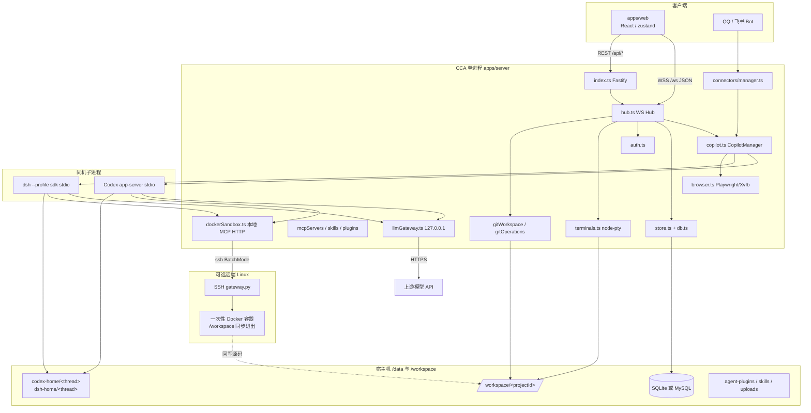
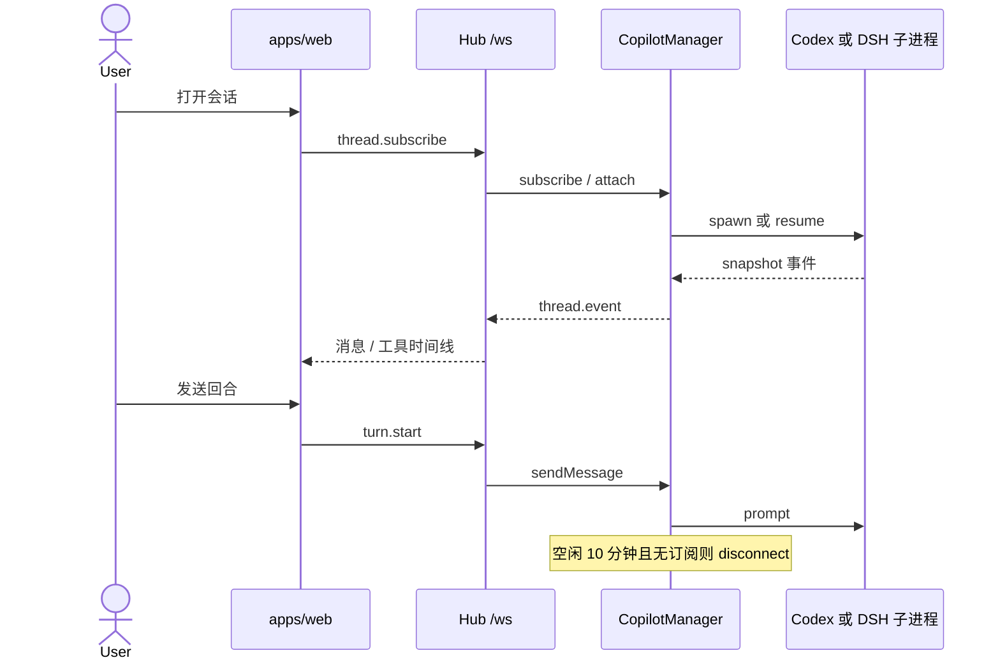
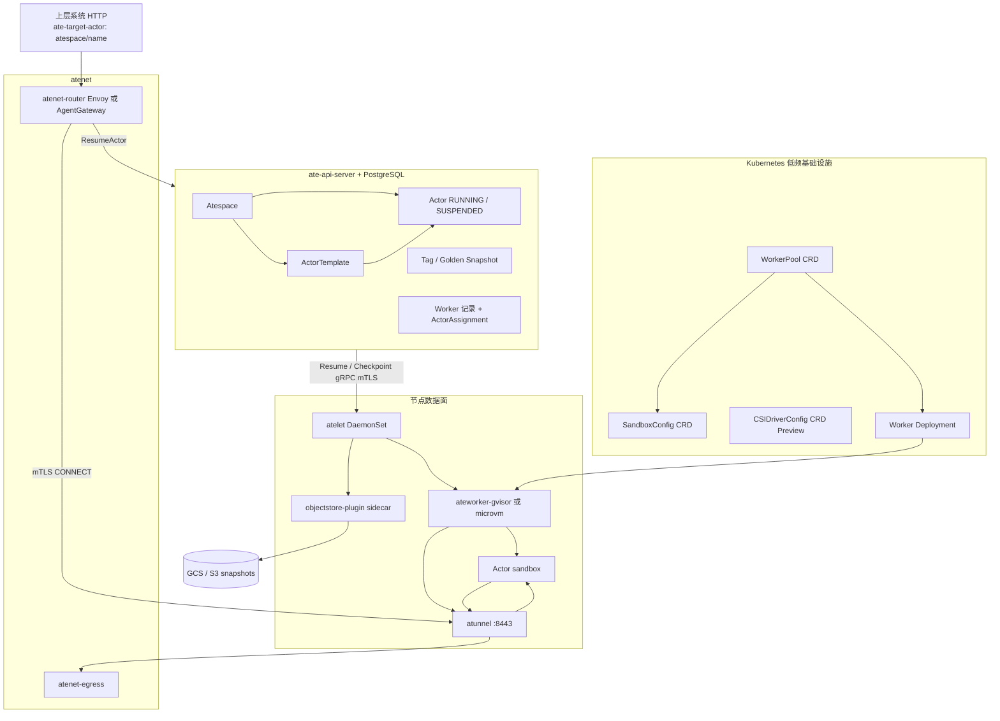
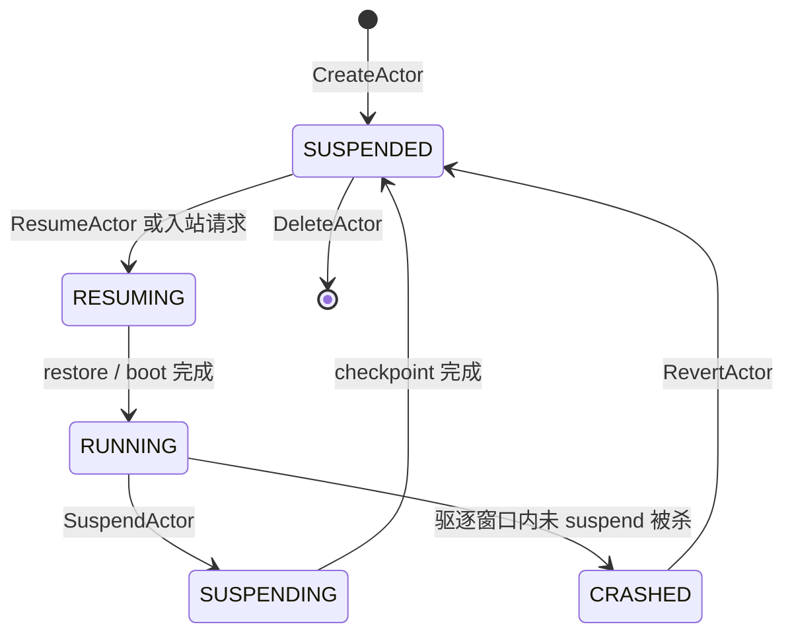
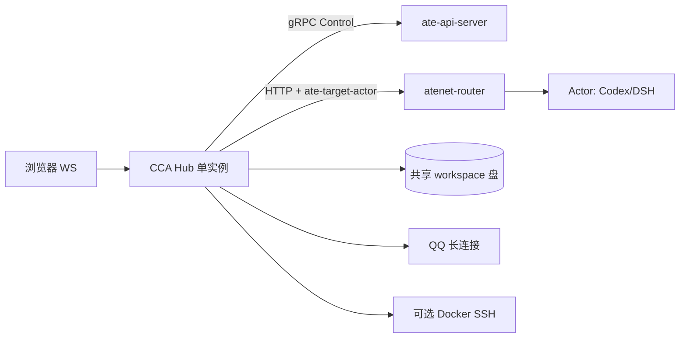
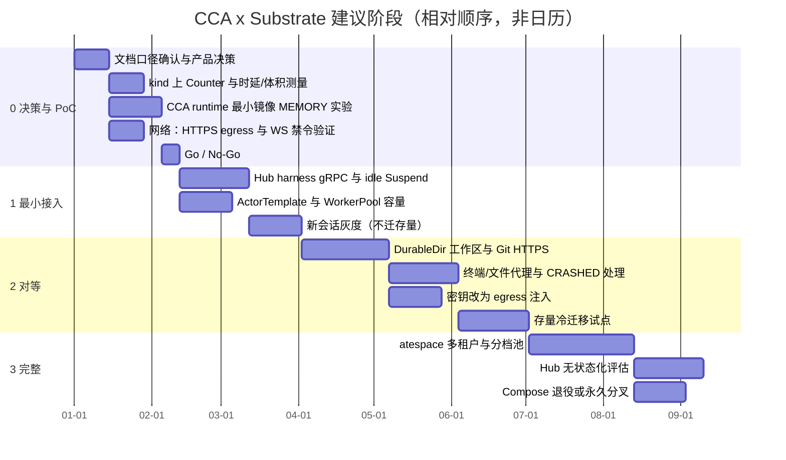

# CCA → Agent Substrate 执行/沙箱架构改造评估

> 状态：架构评估，不改业务代码。  
> 评估日期：2026-11-09  
> 对象仓库：`cloud-coding-agent`（以下简称 CCA）  
> 对照系统：[Agent Substrate](https://ate.dev/docs/get-started/overview/)（以下简称 Substrate）  
> 依据：本仓库源码与 [ate.dev](https://ate.dev) / [learn.agentsubstrate.dev](https://learn.agentsubstrate.dev) 公开文档。未公开的 Substrate 能力一律标为「未知」，不臆造。

---

## 1. 摘要

**总改造量判断：大。**  
把 CCA 从「单进程 Fastify + 本机子进程 Codex/DSH + 可选远端 Docker 代码块」改成 Substrate 的 Actor ↔ Worker 模型，不是换一层容器运行时，而是把控制面、数据面、工作区、网络、密钥和空闲回收全部重切。产品层（Web 对话、Git 面板、QQ/飞书通道、插件市场）Substrate 覆盖不到，必须继续留在 CCA。

最大风险不在「会不会写 gRPC 客户端」，而在三件结构性错配：

1. **网络模型**：CCA 主通道是浏览器 WebSocket，连接器（QQ）也走 WebSocket，远端代码沙箱走 SSH；Substrate 数据面以 HTTP(S) + `ate-target-actor` 为目标，**egress 明确拦截 WebSocket 与非 HTTP TCP**（SSH 在此列）。
2. **空闲语义**：CCA 空闲 10 分钟后 `disconnect()` 杀掉 Codex/DSH 子进程，靠磁盘上的 `CODEX_HOME` / `DSH_HOME` 冷启动续聊；Substrate 的价值在 `MEMORY` checkpoint（进程树 + 内存，公开目标 <500ms 恢复）。要把这个收益拿到，必须把运行时放进 Actor，并自己当 harness 调 `SuspendActor`——公开 API 写明 **Substrate 不会替你自动 suspend**。
3. **工作区共享**：CCA 一个项目目录可被多个会话、Web Git 面板、终端、远端 Docker 同步同时读写；Substrate 的 `DurableDir` 是 **per-Actor** 快照面。多会话共享同一 Git 工作区没有一等公民方案（CSI 卷为 Preview）。

**建议下一步（最小成本验证，不承诺迁移）：**

1. 在 kind 上按 Substrate Quickstart 拉起 `ate-system`，用官方 Counter demo 实测 Resume/Suspend 时延与 snapshot 体积。
2. 打一个最小 CCA runtime 镜像（仅 Codex app-server + 空工作区 HTTP 探活），做成 `ActorTemplate`，验证 gVisor checkpoint 能否冻住 Node 子进程与 stdio JSON-RPC。
3. 明确产品决策：会话 Actor 是「一线程一 Actor」还是「一工作区一 Actor」；Git 工作区是 DurableDir、CSI，还是继续放在控制面宿主机。
4. 在以上 PoC 通过之前，不要拆 CCA 单体。

---

## 2. 评估范围与信息来源

### 2.1 范围内

- CCA 会话/线程生命周期、workspace、Codex/DSH runtime、sandbox/容器/进程隔离、状态持久化、调度与多租户、网络与工具（MCP/插件）、Web/API 边界。
- Substrate 公开的 Actor ↔ Worker 解耦、空闲 checkpoint、预热池、恢复时延、控制面/数据面、API/CRD、atelet/atespace/atenet。
- 差距、改造量、三档方案、路线图、决策点。

### 2.2 范围外

- 不改业务代码、不引入第三种 CLI agent、不实现接入层。
- 不评估商业条款、许可证费用、SLA（公开文档未给出生产 SLA）。
- 不把 Substrate overview 的营销数字（「百万级 Actor」「10x 密度」）当作已验证的 CCA 容量承诺。

### 2.3 主要文档

| 主题 | URL |
| --- | --- |
| Overview | https://ate.dev/docs/get-started/overview/ |
| Architecture | https://ate.dev/docs/concepts/architecture/ |
| Quickstart | https://ate.dev/docs/get-started/quickstart/ |
| Glossary | https://ate.dev/docs/reference/glossary/ |
| Resource model | https://ate.dev/docs/reference/resource-model/ |
| API / CRD | https://ate.dev/docs/reference/api-guide/ |
| Sandbox classes | https://ate.dev/docs/reference/sandbox-classes/ |
| Egress traffic | https://ate.dev/docs/guides/egress-traffic/ |
| Network egress | https://ate.dev/docs/guides/network-egress/ |
| Credential injection | https://ate.dev/docs/guides/egress-credential-injection/ |
| Operator install | https://ate.dev/docs/guides/operator-install/ |
| Topology | https://learn.agentsubstrate.dev/topology |
| Resume / Suspend flows | https://learn.agentsubstrate.dev/flows/resume-actor/ 、 https://learn.agentsubstrate.dev/flows/suspend-actor/ |

GKE 安装指南在 Overview 中有入口，本次抓取 `https://ate.dev/docs/get-started/gke/` 返回 404。GKE 相关信息改从 Operator Install / API Guide 中间接引用，细节标「未知」。

---

## 3. CCA 现状（仓库事实）

### 3.1 一句话

CCA 是 **单进程控制面 + 同机执行面**：Fastify 托管 REST/WebSocket/静态前端；每个打开的会话再拉起一个 Codex `app-server` 或 `dsh --profile sdk` 子进程；工作区是宿主机（或 Compose 挂载）上的真实目录；可选地把 **模型生成的 JS 代码块** 经 SSH 丢到远端 Docker 里跑完再把文件差量写回。用户隔离是应用层 `userId` / `ownerId`，不是容器级多租户。

### 3.2 模块与入口

| 子系统 | 职责 | 关键入口 |
| --- | --- | --- |
| 进程入口 / HTTP | Fastify、鉴权 REST、静态 Web、WS 升级、浏览器 VNC 代理 | `apps/server/src/index.ts` |
| WS 控制面 | 协议分发、权限、会话 CRUD、Git/终端/插件/连接器 | `apps/server/src/hub.ts` |
| 协议 | 前后端唯一消息/领域类型 | `packages/protocol/src/index.ts` |
| 会话编排 | attach/detach、回合、权限审批、历史重建 | `apps/server/src/copilot.ts`（`CopilotManager`） |
| 引擎接口 | Codex/DSH 共用的 `AgentClient`/`AgentSession` | `apps/server/src/agentRuntime.ts` |
| Codex | 每会话 `codex app-server --listen stdio://` | `apps/server/src/codex.ts`、`codexRpc.ts` |
| DSH | 每会话 `dsh --profile sdk` + 会话 patch | `apps/server/src/dsh/dshClient.ts`、`dshConfig.ts` |
| LLM 网关 | 本机环回 HTTP，把 Codex Responses 转到 Chat Completions | `apps/server/src/llmGateway.ts` |
| 工作区 | 用户目录、文件树、读写、Git 面板 | `workspaceProjects.ts`、`workspace.ts`、`gitWorkspace.ts` |
| 认证 Git | clone/fetch/pull/push，令牌不进 URL | `gitOperations.ts`、`gitBindings.ts` |
| Docker 代码沙箱 | SSH → 远端 gateway → 一次性容器 | `dockerSandbox.ts`、`deploy/docker-sandbox/` |
| 浏览器 | 每会话 Xvfb + Chromium + x11vnc + noVNC | `apps/server/src/browser.ts` |
| 终端 | `node-pty`，每所有者最多 10 个 | `apps/server/src/terminals.ts` |
| MCP / Skill / 插件 | 平台 + workspace + Agent Plugins 1.0 | `mcpServers.ts`、`skills.ts`、`agentPlugins.ts` |
| 通道 | QQ / 飞书 → 复用 `CopilotManager.sendMessage` | `connectors/manager.ts`、`qq.ts`、`feishu.ts` |
| 存储 | SQLite/MySQL + JSON 回退 + 每会话 home 目录 | `db.ts`、`store.ts`、`threadEvents.ts`、`env.ts` |
| 鉴权 | 本地用户、JWT、邀请码、管理员引导 | `apps/server/src/auth.ts` |
| 前端 | React 19 + zustand + 自研 WS 客户端 | `apps/web/src/lib/client.ts`、`store.ts` |
| 部署 | 单容器 Compose；生产外接 MySQL | `Dockerfile`、`docker-compose-*.yml`、`README.md` |

### 3.3 现状架构图

### 3.4 会话 / 线程生命周期

创建路径：`thread.create`（`packages/protocol` → `Hub`）写入 `ThreadMeta`（id 为 UUID，绑定 `projectId`、`userId`、`runtime=codex|dsh`、模型、权限模式），可选立刻 `subscribe` + `sendMessage`。

热路径：

1. `CopilotManager.subscribe` 增加订阅计数，取消 10 分钟 detach 定时器，必要时 `attach`。
2. `attach` 按 runtime 取 `CodexClient` / `DshClient`，`resumeSession` 失败再 `createSession`（DSH 一律 `createSession`，内部若已有会话目录则 `session/resume`）。
3. Codex：`CodexRpc.start` spawn `codex app-server`，会话 home 为 `$CCA_DATA_DIR/codex-home/<threadId>`，工作目录为项目 `path`。
4. DSH：`prepareDshHome` 写 `$CCA_DATA_DIR/dsh-home/<threadId>` 与 `--patch`，再 `HarnessClient` spawn。
5. 回合结束、无订阅者且不在 compact/reconfigure：`DETACH_IDLE_MS = 10 * 60 * 1000` 后 `session.disconnect()`，**进程退出，磁盘状态保留**。
6. 归档满 30 天由 Hub 定时清掉（`ARCHIVED_THREAD_RETENTION_MS`）。

这不是 CRIU。下次打开会重新拉起进程，从 JSONL/`thread_events` + 引擎原生历史重建 UI。Codex 断线有 `codexReconnect.ts` 重连；DSH abort 只能杀子进程再 resume。

权限模式映射到引擎沙箱（不是 Substrate 那种 gVisor/microVM）：

| CCA `permissionMode` | Codex | DSH |
| --- | --- | --- |
| `request` / `auto` | `workspace-write`，无网络 | `workspace-write` |
| `full`（默认） | `danger-full-access` | `danger-full-access` |

`request` 模式下 Codex 把审批打到 Web；DSH SDK **不支持交互审批**，升级策略固定拒绝。

### 3.5 Workspace

- 用户通过 `workspace.create` 在 `WORKSPACE_ROOT`（默认 `/workspace`）下建 `$WORKSPACE_ROOT/<uuid>/`，mode `0700`，记录为 `Project { id, name, path, ownerId }`。
- 会话 `cwd` = 该绝对路径。Web 文件树、Git 面板、终端、Agent 工具、Docker 沙箱同步 **全部打在同一棵树**。
- 多会话可以挂同一个 `projectId`，没有文件锁；Git 写操作用 `withProjectGitMutation` 串行化同一仓库的突变。
- 工作区不得覆盖 `DATA_DIR` 或其他项目路径（`deniedWorkspacePaths`）。
- Compose 把宿主机目录 bind-mount 进容器；生产示例甚至挂了 `/home/nolaurence/dev` → `/codeprojects`。这是 **共享文件系统产品**，不是 per-session overlay。

### 3.6 沙箱 / 容器 / 进程隔离

CCA 实际有 **三层互不相同的「沙箱」**，评估时不能混为一谈：

| 层 | 隔离对象 | 机制 | 生命周期 |
| --- | --- | --- | --- |
| 引擎文件沙箱 | Codex/DSH 在会话 cwd 上的读写 | 引擎内置 `workspace-write` / `danger-full-access` | 随子进程 |
| 应用进程 | 用户之间 | **无**。所有用户共享一个 Node 进程、一个 UID | 服务进程 |
| Docker 代码块 | `run_code` 里的 JS/shell | SSH 到远端，每代码块一个非 root、只读根、2 CPU / 2 GiB、可选 `--network none` 的容器 | **一次调用**；依赖/缓存不保留 |

远端 Docker（`deploy/docker-sandbox/README.md`）明确：

- Agent 模型调用仍在 CCA 服务内；只有代码块进容器。
- 每次从本地工作区同步普通文件（跳过 `.git`、`node_modules` 等，上限 8 MiB/文件、64 MiB、10000 文件），跑完回写，再删远端目录。
- Git 元数据不同步；认证 Git 走平台工具。
- 配置存在但 SSH/镜像失败时 **失败关闭**，不回退本地执行。

浏览器是另一类进程隔离：每线程一套 Xvfb/Chromium/VNC，默认禁私网；通过同源 `/browser-vnc` 把 noVNC 接到本机 websockify。

终端是 `node-pty`，环境白名单化，`HOME` 指到 cwd。

### 3.7 状态持久化

双轨，缺一不可：

1. **应用库**：`DATABASE_URL=sqlite:` 或 `mysql://`；表 `threads`（JSON blob）、`projects`、`settings`、`users`、`thread_events`、`thread_shares`、`registration_settings`。未配则 JSON 文件（`threads.json` 等）。写操作串行队列。
2. **引擎原生目录**：`codex-home/<id>/`（`cca-thread.json`、`cca-events.jsonl`、Codex sessions）、`dsh-home/<id>/`（DSH sessions + 同样的应用事件日志）。README 写明：**数据库不能替代 Codex 原生状态，备份必须同时覆盖库和数据目录。**

其它落盘：加密 Git token（`git-bindings.json` + `secret.key`）、插件包、`PLUGIN_DATA`、上传附件、沙箱冲突恢复 `sandbox-recovery/`。

Standalone 约束：**不要让多个实例同时读写同一个 SQLite 文件。** 没有会话调度器，没有水平扩展。

### 3.8 调度与多租户

| 能力 | 现状 |
| --- | --- |
| Worker 池 / 预热 | 无 |
| 空闲回收计算 | 仅杀子进程；Node 主进程、浏览器、pty、磁盘占用仍在 |
| 把会话迁到另一台机器 | 无；状态绑在本机 `$CCA_DATA_DIR` + workspace 路径 |
| 用户隔离 | 逻辑：会话 `userId`、项目 `ownerId`、分享只读/协作、管理员可见全部 |
| 进程/内核隔离 | 无。同一 OS 用户跑所有 Codex/DSH/MCP stdio |
| 配额 | 无明显 per-user CPU/内存配额；`runtimeResources.ts` 读的是 **本 Pod/本机** 指标给 UI，不是调度输入 |
| K8s | 仅 Metrics API 可选；仓库无 Deployment/Helm |

### 3.9 网络与工具

- **北向**：浏览器 `ws(s)://<host>/ws?token=`；REST `/api/auth/*`、`/api/admin/*`、上传、项目文件、浏览器 ticket。几乎所有产品操作都在 WS 上（见 `ClientMessage`）。
- **南向 LLM**：会话级环回网关，子进程只拿随机 token，上游 API key 留在 CCA 进程。
- **MCP**：stdio 或 HTTP；平台设置 + workspace `.mcp.json` + 插件贡献。Codex 可工具白名单；DSH 注册全部工具。
- **插件市场**：Agent Plugins 1.0 + Claude/Codex 兼容布局；安装到数据目录，stdio MCP 注入 `PLUGIN_ROOT`/`PLUGIN_DATA`。
- **Git 凭据**：服务端加密保存，`authenticated_git` 用一次性环境，不写 `.gitconfig`。
- **连接器**：QQ（`api.sgroup.qq.com` + 机器人 WebSocket）、飞书；入站消息转成 `sendMessage`，共用同一工作区会话。

### 3.10 Web / API 边界

前端不直接碰引擎。把执行搬进 Substrate Actor 后，要么：

- 继续让 Hub 做唯一 WS 入口（Actor 只被 Hub 用 HTTP/gRPC 叫醒），或
- 让浏览器直连 Actor——公开文档要求 **反向代理** 注入 `ate-target-actor` 与 mTLS，浏览器自己加不了该头。

---

## 4. Agent Substrate 公开模型

### 4.1 要解决的问题

Agent 类负载大部分时间在等用户/模型/外部事件，却常被做成单租户沙箱，Idle Pod 浪费严重；kube-scheduler 冷启动是秒级，不适合「工作几秒、等待无上界」的会话。Substrate 的回答：把 **Actor（逻辑会话）** 从 **Worker（预热好的沙箱容量）** 解开，空闲时 checkpoint，请求来了再 restore 到任意兼容的暖 Worker。

### 4.2 控制面 / 数据面

要点（公开文档）：

- **K8s 只管容量**：`WorkerPool` / `SandboxConfig` / `CSIDriverConfig` 是 CRD。Actor、Template、Tag、Atespace、Worker 记录在 PostgreSQL，避免 etcd 被百万级对象打爆。
- **atecontroller** 把 WorkerPool 调成 Deployment，并同步 Worker 记录。
- **ate-api-server** 做 Actor 调度、Resume/Suspend/Revert/Delete 工作流、golden snapshot 调和；鉴权 mTLS/OIDC，授权嵌入 OpenFGA，按 atespace。
- **atelet** 每节点 DaemonSet：拉镜像、拼 OCI bundle、经 Unix socket 调 ateworker 的 `RunWorkload` / `CheckpointWorkload` / `RestoreWorkload`，快照经 sidecar 上下对象存储。atelet **自己没有对象存储凭证**。
- **Worker 预热**：每个 worker pod 可同时托管多个 Actor（`--max-actors` 默认 1000，同时受 CPU/内存预算约束）。调度在控制面原子分配，**kube-scheduler 不在热路径**。
- **Sandbox class**：`gvisor`（runsc CRIU）或 `microvm`（Kata + Cloud Hypervisor，需 `/dev/kvm`）。一旦拍了快照，class 不可互换。
- **快照保真度**：`VOLUMES` ⊂ `ROOTFS` ⊂ `MEMORY`（默认 MEMORY）。
- **本地加速**：suspend 后节点保留 locality，同节点 resume 免对象存储；`--snapshot-detach-delay` 默认 30 分钟后丢掉本地副本。异步 suspend 默认 `--snapshot-upload-delay` 5 分钟才上传；节点在上传完成前挂掉会丢这次快照。

### 4.3 Actor 生命周期

公开 RPC：`CreateActor`、`UpdateActor`、`ResumeActor`、`SuspendActor`、`RevertActor`、`DeleteActor`、`Get/ListActors`、`Get/ListWorkers`。

**空闲自动回收（文档冲突，按严格口径）：**

- Overview / Quickstart 叙述「actor 空闲后会被 checkpoint」。
- Architecture 生命周期、API Guide Eviction、Counter 教程写明：**Substrate 不会替你 Suspend**；harness（或 `kubectl ate suspend`）必须显式调用。驱逐时 worker 给 Actor 主进程 `SIGTERM`，**30 分钟**内必须 `SuspendActor(SYNCHRONOUS)`，否则 `CRASHED`，只剩上一次外部快照。
- 因此 CCA 若接入，**必须自己实现 idle suspend 策略**（可复用今天的 10 分钟 detach），不能假设平台会在「没人说话」时自动休眠。

恢复时延：Overview 写 **under 500ms**；Architecture North Star 是激活 p95 **100ms**、单集群 1000 wakeups/s。这是平台目标，不是 CCA 负载下的测量值。冷启动（无 golden、无本地 locality、大 ROOTFS）时延 **未知**。

### 4.4 网络

- 入站：上层必须连 `atenet-router`，头 `ate-target-actor: <atespace>/<name>`。Router 调 Resume，再 mTLS CONNECT 到 worker `atunnel:8443`，转发到 Actor 默认端口 80。非 80 端口用 HTTP CONNECT。**今天只支持隧道里的 HTTP(S)**；裸 TCP/其它协议「not yet reachable」。
- WebSocket **入站**：API Guide 允许在 upgrade 请求上带同一路由头；浏览器做不到，生产要用户侧反向代理。
- 出站：除 DNS:53 外全部进 atunnel → `atenet-egress`。GA 表：HTTP(S) 1.1/2 受策略控制；`tls_passthrough` 可放行该 SNI 上的 WebSocket 等；**明文/MITM 路径上的 WebSocket、HTTP CONNECT、其它 TCP 一律拦截**；非 53 的 UDP 丢弃。Actor 网络 **仅 IPv4**。169.254.0.0/16 被 ateworker 丢掉（内部 `169.254.17.0/30` 除外）。
- 密钥：egress `replaceHeaders` 把占位符换成 Secret / Actor JWT，**密钥永不进沙箱、也不能被 snapshot**。

### 4.5 对编码场景的公开表态

API Guide §8：「Claude Code & CodeX」被点名为目标负载——每个开发者一个持久终端 Actor，集群只为活跃用户跑物理 pod，文件系统 delta 靠快照保留。这与 CCA 的方向一致，但文档没有给出 Codex app-server、node-pty、Chromium、stdio MCP 的 checkpoint 兼容性证据。

---

## 5. 概念对照

| CCA 概念 | 最接近的 Substrate 概念 | 对齐程度 |
| --- | --- | --- |
| Fastify + Hub 控制面 | 上层 harness；**不是** ate-api-server | 需自建，调用 Control gRPC |
| `ThreadMeta` / 一次编码会话 | `Actor`（`atespace` + DNS-1123 name） | 可映射；UUID 需规范化为 label |
| `Project` / Git 工作区 | `DurableDir` 或 CSI volume（Preview） | 弱。多会话共享目录无对应物 |
| Codex/DSH 子进程 | Actor 内容器主进程（或 sidecar） | 可放进 Actor；checkpoint 可行性未知 |
| 10 分钟 `detach` | harness 调 `SuspendActor` | 语义要升级：杀进程 → 冻内存 |
| `codex-home` / `dsh-home` 磁盘 | ROOTFS 或 DurableDir | MEMORY 快照可部分替代 |
| `thread_events` / 用户/设置库 | 仍应留在 CCA（PostgreSQL/SQLite） | Substrate PG 不存业务消息 |
| Docker `run_code` 一次性容器 | 不匹配。Substrate Actor 是长寿命可冻会话 | 不应 1:1 替换 |
| Compose 单容器 | `WorkerPool` + 系统组件 Deployment | 部署模型全换 |
| 用户 / JWT | Atespace + OpenFGA；或 CCA 用户系统保持 | 产品身份 ≠ atespace |
| `llmGateway` 环回 | Actor 内 localhost（不经 PEP）或 egress HTTPS | 可适配 |
| Git token 文件 | egress credential injection | 应对齐，但 Git SSH 走不通 |
| QQ WS 连接器 | 无。且 Actor egress 默认禁 WS | 必须留在 Actor 外 |
| 插件市场 / Skill | 无。可作为镜像层或 DurableDir | 产品层自管 |
| 浏览器 noVNC WS | Actor 内 localhost 可能；出站 WS 不行 | 高风险 |
| 终端 pty | Actor 内进程；需 HTTP/WS 桥到 Hub | 中 |

---

## 6. 差距分析

图例：**对得上** / **适配桥接** / **要重写** / **覆盖不到**。

### 6.1 总表

| 能力 | 判定 | 说明 |
| --- | --- | --- |
| 把空闲编码会话从计算上拿走、请求来再热恢复 | 适配桥接 | 正是 Substrate 的核心；CCA 今天只杀进程。需自建 harness 的 Resume/Suspend，以及 SIGTERM 驱逐处理 |
| 预热池、避开 kube-scheduler | 对得上 | WorkerPool.replicas；CCA 无此层，属新增平台能力 |
| 高密度多 Actor 同 Worker | 对得上（平台） | 密度取决于每 Actor 的 CPU/内存 limits；编码会话内存未知，可能远大于 Counter demo |
| gVisor / microVM 强隔离 | 要重写 | 替换「同 UID 子进程 + 可选远端 Docker」。涉及镜像、seccomp、无 Docker socket |
| 控制面 Actor 状态机 | 适配桥接 | Hub 增加 Actor 引用；不要把 `ThreadMeta` 搬进 ate PG |
| 对话/工具事件、分享、归档 | 覆盖不到 | 继续 `thread_events` + Web 协议 |
| Git 工作区作为长期可写目录 | 适配桥接 / 部分覆盖不到 | DurableDir 跟 Actor 走；共享工作区、大 `node_modules`、跨会话 Git index 需产品决策。CSI 为 Preview |
| Codex / DSH 协议与工具时间线 | 覆盖不到（产品）+ 适配（进程安置） | 引擎仍由 CCA 维护；只是 spawn 地点变化 |
| 本机 LLM 网关藏 API key | 适配桥接 | 更好的模型是 egress 注入，子进程连公网 HTTPS 只带占位符 |
| MCP stdio | 适配桥接 | 进程在 Actor 内，随 MEMORY 快照；gVisor 对 spawn/pty 的限制未知 |
| MCP HTTP | 适配桥接 | 需 EgressPolicy 放行对应 hostname |
| 远端 Docker SSH 沙箱 | 要重写或放弃 | SSH 为非 HTTP TCP，GA egress **拦截**。不能从 Actor 内直连现有 gateway |
| 浏览器自动化 + noVNC | 要重写或外置 | Xvfb/Chromium checkpoint 未知；VNC/WebSocket 出站被拦；可把浏览器留在控制面主机 |
| 交互终端 | 适配桥接 | pty 必须在 Actor 内才有意义；Hub 需新增到 Actor 的 WS/HTTP 多路复用，且 Actor 迁移后重连 |
| QQ / 飞书 | 覆盖不到 | 长连接必须留在 CCA 控制面（egress 禁 WS，除非 tls_passthrough 且能接受 MITM/SNI 约束） |
| 插件市场 UI / 本地 `plugins/` | 覆盖不到 | 安装产物可打进镜像或挂 DurableDir |
| 用户注册、邀请码、管理员 | 覆盖不到 | 与 OpenFGA/atespace 是不同平面 |
| 多实例 / 多租户硬隔离 | 要重写 | 今天单进程；目标是每 Actor 一沙箱 + atespace。工作区与 MySQL 仍要自己做租户边界 |
| Compose 单机开箱 | 覆盖不到 | Substrate 依赖 K8s + PG + 对象存储；个人 Standalone 路径需并行保留或放弃 |
| GPU | 覆盖不到 | 文档：devices 暂时不传给 Actor。CCA 当前也不需要 |
| 激活 <500ms | 未知 | 取决于 snapshot 体积（Git 工作区可达数百 MB–数 GB）与是否同节点 locality |
| 水平扩展 Hub | 要重写 | 即便 Actor 可迁移，Hub 仍是单机内存（`CopilotManager.threads`、connector、pty） |

### 6.2 特别不匹配：Docker 代码沙箱

把 `cca_sandbox.run_code` 换成「每个代码块一个 Substrate Actor」是错误抽象：

- Substrate Actor 为长寿命、可冻结、有 golden snapshot 的会话设计。
- CCA 沙箱是 **无状态、每次空目录、刻意丢掉 node_modules**。
- 创建 Actor + golden/cold boot 的固定成本远高于 `docker run` 一个短容器。

可选方向（都不是 1:1）：

1. **丢掉远端 Docker**，让 Agent 在 Actor 内直接 `exec`（MEMORY 快照保留构建缓存——与当前「缓存不跨代码块」策略相反，是产品变更）。
2. 保留远端 Docker，但 **执行点仍在 Hub 所在网络**（Actor 外），继续 SSH；则 Substrate 帮不上这段。
3. 另做 HTTP 代码执行服务当普通上游，由 Actor 经 HTTPS egress 调用。工作量大，且失去「文件在同一 workspace」的简单性。

### 6.3 产品层：Substrate 不管

这些必须永远留在 CCA（或后继产品后端），最多把「跑 Agent 的那台电脑」换成 Actor：

- 中文 Web 工作台、会话概览、轨迹、Office 预览、分享链接
- Git 图形面板（status/log/diff/stage/commit/push）
- QQ/飞书通道、模型提供方配置、BYOK
- 插件市场、Skill 编辑、MCP 管理 UI
- 用户/邀请码/管理员
- 图片生成附件流

API Guide 把 Substrate 定位为 **execution runtime for any framework**，不是编码 IDE。

---

## 7. 改造量（人天 / 人周）

口径：熟悉 CCA 的后端 + 具备 K8s 能力的工程师，**人周**；括号内为不确定度。不含组织决策空窗、不含「第一次把 Substrate 当生产平台」的平台团队编制（那部分单独列在运维）。1 人周 ≈ 5 人天。

| 子系统 | 最小可行接入 | 对等替换 | 完整迁移 | 不确定度 | 主要工作 |
| --- | --- | --- | --- | --- | --- |
| 控制面 | 3–5 周 | 8–12 周 | 12–18 周 | 中 | gRPC 客户端、atespace 规划、Create/Resume/Suspend/Delete 与 `thread.*` 对齐、驱逐 SIGTERM 通道、OpenFGA 与现有 JWT 并存 |
| 会话状态 | 2–4 周 | 6–10 周 | 10–16 周 | **高** | 进程迁入 Actor；MEMORY vs 现有 home 目录双写；checkpoint 后 stdio RPC 是否还活；失败回退冷启动 |
| 沙箱执行 | 3–6 周 | 8–14 周 | 12–20 周 | **高** | 放弃或外置 Docker SSH；权限模式对照 EgressPolicy；镜像内 Codex/DSH/skills；gVisor 兼容 |
| 存储 / 快照 | 2–3 周 | 6–10 周 | 8–14 周 | 高 | DurableDir 装 cwd；snapshot 体积与排除 `node_modules`；对象存储成本；与 MySQL 事件的一致性 |
| 网络 / 隧道 | 2–4 周 | 6–12 周 | 8–16 周 | **高** | Hub↔Actor HTTP；WS 代理；egress 白名单；密钥注入；QQ/SSH 明确外置 |
| 前端 / 协议 | 0.5–1 周 | 3–6 周 | 6–10 周 | 中 | 最小档几乎不动；对等档要暴露 Actor 状态、恢复中、CRASHED；完整档可能改 WS 拓扑 |
| 运维与部署 | 4–8 周 | 8–12 周 | 10–16 周 | 中高 | kind/GKE、WorkerPool 容量、对象存储、观测、滚动升级与 30 分钟 drain、保留或放弃 Compose |
| 数据迁移 | 0–1 周 | 4–8 周 | 8–14 周 | 高 | 最小档不迁存量；对等档要把 home+workspace 灌进 Actor/卷；完整档还要租户 atespace 切分 |
| **合计（工程）** | **17–32 人周** | **49–84 人周** | **74–124 人周** | | 约 4–8 个月 / 6–12 个月 / 9–18 个月（2 人并行粗算） |
| 平台团队（Substrate 生产化） | +4–8 周 | +8–16 周 | +12–24 周 | 高 | 若不存在现成 ate-system 集群，必须另计 |

**总判断：大。** 最小档已经超过「加一个适配器」的规模，因为运维面从 Compose 变成 K8s + 对象存储，且必须做 checkpoint PoC 才能知道会话状态那一行是 2 周还是 14 周。

不确定度最高的三行（会话状态、沙箱、网络）任一行 PoC 失败，都会把「对等替换」推回「最小接入」或直接否决 MEMORY 方案。

---

## 8. 三档方案

### 8.1 最小可行接入（MVP）

**定义：** CCA 单体控制面不动。新增「执行后端」：每个 **活跃编码线程** 对应一个 Substrate Actor，内里只跑 Codex 或 DSH（加最小 HTTP wakeup probe）。Hub 在 `attach` 时 `ResumeActor`，在现有 10 分钟 idle 时 `SuspendActor(async)`，驱逐路径走 sync。工作区 **暂时仍用今天的共享 FS**（通过未知/Preview 的卷，或先只把无共享需求的新会话放进 DurableDir）。QQ、浏览器、终端、Docker SSH、插件市场全部留在 Hub 主机。

| | |
| --- | --- |
| 成本 | 17–32 人周工程 + 4–8 周平台；需一块 K8s 与对象存储 |
| 收益 | 验证 Resume 时延与 gVisor+Node 兼容；空闲会话不再常驻 Worker CPU；为后续拆分探路 |
| 风险 | 工作区仍是共享盘则隔离收益很小；Actor 内进程打不开 SSH 沙箱；Hub 仍是单点；MEMORY 快照可能冻不住 Codex；异步 suspend 丢快照 |
| 不做的 | 多租户硬隔离、终端进 Actor、迁移存量、替换 Compose 给个人用户 |

**退出条件：** 若 Counter 级 Resume <500ms，但 CCA 镜像 + 100MB 工作区 Resume >5s 或 checkpoint 后 Codex stdio 死掉，则停止加码，保留 CCA 现状。

### 8.2 对等替换

**定义：** 对用户可感知的「打开会话就能继续写代码」做到与今天相当，但执行落在 Substrate 上。

必须完成：

- 一线程（或一工作区）一 Actor，golden snapshot 预热 Codex/DSH 启动。
- cwd 进 DurableDir；Git 面板/终端的 IO 打到 Actor（或 CSI 共享卷，Preview，需单独决策）。
- Hub 保持 WS 门面；内部把 `turn.start`、文件、Git、pty 代理进 Actor。
- LLM、Git HTTPS、远程 MCP 走 egress + 凭据注入；**禁用 Git SSH 与 Actor 内 Docker SSH**。
- QQ/飞书仍在 Hub；浏览器二选一：留 Hub（现状）或 Actor 内无头浏览器（checkpoint 风险）。
- 存量会话：至少能冷启动（ROOTFS/VOLUMES + 现有 `codex-home` 拷入），不保证第一天 MEMORY 热恢复。
- 部署：生产 CCA Hub Deployment + ate-system；Standalone Compose 标为「无 Substrate」变体。

| | |
| --- | --- |
| 成本 | 49–84 人周工程 + 8–16 周平台 |
| 收益 | 真正拿到密度与强隔离；空闲编码会话可从节点内存消失；密钥可移出沙箱 |
| 风险 | 共享 Git 工作区产品变更；WS/pty 在 Actor 迁移后的重连；snapshot 成本；gVisor 与 node-pty/Chromium；Hub 仍难水平扩展 |
| 依赖 | MVP PoC 必须先绿 |

### 8.3 完整迁移

**定义：** 执行面完全以 Substrate 为源；CCA 退化成「ATES 上的编码产品控制面」。含：按用户/团队 atespace、WorkerPool 分档（request vs full 对应不同 egress 与 limits）、存量双轨迁移、观测/SLO、滚动升级与 SIGTERM 处理、可能的 Hub 无状态化（会话运行时全部在 Actor，Hub 只做鉴权与路由）、个人版要么放弃要么提供「内嵌 kind」——后者成本通常不值得。

| | |
| --- | --- |
| 成本 | 74–124 人周工程 + 12–24 周平台 |
| 收益 | 多租户硬隔离、接近「百万空闲会话」的容量模型、运维与 K8s 对齐 |
| 风险 | 范围膨胀到重写产品后端；Substrate Preview（CSI、部分 egress 特性）进生产；组织上要把 CCA 团队变成平台消费者 |
| 不包含 | Substrate 不会长出 QQ 连接器或插件市场；那些永远是 CCA 产品代码 |

---

## 9. 分阶段路线图

阶段 0 的 Go/No-Go 门禁（建议全部满足才进入阶段 1）：

1. 在目标 sandbox class（建议先 **gvisor**，节点需求低）上，CCA 最小镜像 `SuspendActor` + `ResumeActor` 后 Codex stdio 仍能 `thread/resume` 或等价 RPC。
2. 含典型小仓库（数十 MB 源码、无 `node_modules`）的 snapshot 上传/恢复时间可被产品接受（需实测；公开 500ms 很可能只覆盖内存态、同节点 locality）。
3. 确认 LLM HTTPS 经 egress 注入可用；Git SSH、QQ WS、Docker SSH 明确列为 Actor 外。
4. 有人拥有 ate-system 的生产级升级与快照桶。

---

## 10. 关键决策点

1. **Actor 粒度**  
   - 一线程一 Actor：隔离好、快照简单、工作区复制或不能共享。  
   - 一工作区一 Actor：贴近今天「项目目录」，多会话抢同一 cwd 与同一进程模型，和当前「每会话独立 CODEX_HOME」冲突。  
   - **未知最优解**；建议 PoC 用一线程一 Actor。

2. **MEMORY vs ROOTFS vs 继续杀进程**  
   MEMORY 才对得上 Substrate 的时延故事。若 Codex/pty 不能冻，退回 ROOTFS + 现有 home 目录，则 Substrate 退化成「贵的 gVisor 主机」，收益可能不抵运维成本。

3. **共享 Git 工作区是否保留**  
   若必须保留多会话/多人同时改同一目录，需要 CSI（Preview）或把 Git 操作全部留在 Hub 挂载盘——后者让 Actor 变「无盘推理进程」，削弱沙箱意义。

4. **Docker `run_code` 的去留**  
   与 Actor 内 exec 二选一。并存则网络（SSH）过不去。

5. **浏览器与终端放哪**  
   进 Actor：体验与快照一体，checkpoint 风险高。留 Hub：实现快，隔离弱，空闲仍占本机资源。

6. **Standalone 产品是否还要**  
   Substrate 没有「单进程 SQLite」形态。个人部署要么继续走今天的 Compose（永久双栈），要么要求用户自备 K8s。

7. **谁当 harness**  
   公开文档把 idle suspend / 驱逐 suspend 的责任放在上层。CCA Hub 必须成为这个上层，并处理 `RESOURCE_EXHAUSTED`、`CRASHED`、异步快照 `PENDING`。

8. **密钥平面**  
   继续把 provider API key、Git token 放进 Actor 环境，会被 MEMORY 快照带走，与 Substrate 威胁模型相反。完整迁移应以 egress injection + SystemInfo 为准。

9. **Sandbox class**  
   编码工具链更可能踩 gVisor 系统调用黑名单；microVM 更像真机但要 KVM 与 ≥128MiB。**未知** CCA 镜像在哪边能 checkpoint。不要假设可在两类之间迁移已有快照。

10. **文档冲突：自动 idle checkpoint**  
    产品文案与 API 不一致。实现必须以 `SuspendActor` 为准，否则驱逐会丢会话。

---

## 11. 未知清单（公开文档或仓库未给出）

| 项 | 为何重要 |
| --- | --- |
| gVisor/microVM 对 Node 22 + Codex app-server + `dsh` + node-pty + Chromium/Xvfb 的 checkpoint/restore 成功率 | 决定能否用 MEMORY |
| 含 Git 工作区的 snapshot 体积、压缩比、Resume p95 | 决定 500ms 是否与编码场景有关 |
| CSI `external` 卷在编码场景的稳定性和是否可多 Actor 挂载同一 PVC | 共享工作区 |
| GKE 安装的完整步骤与区域限制（本评估未读到独立 GKE 指南页） | 生产落地 |
| Substrate 版本成熟度、支持周期、非 GKE 发行版（EKS/自建）官方支持范围 | 平台选型 |
| `atenet-router` 对 **长寿命** WebSocket 在 Actor 从 Worker A 迁到 B 之后是否能逐请求重挂 | 终端与 `/ws` 代理 |
| 默认 Worker 内存开销、每编码 Actor 建议 `cpuMillicores`/`memoryBytes` | 容量规划 |
| 对象存储账单与快照 GC 在「每用户多个 GB 工作区」下的表现 | 成本 |
| OpenFGA 模型与 CCA 用户角色如何联邦 | 完整多租户 |
| Preview 门（CSI、PerTemplateSnapshotLocation、GoldenEgressPolicy）何时转 GA | 能否当生产依赖 |

---

## 12. 建议的立即下一步（仍不改业务代码）

1. **平台 PoC（约 1–2 人周）**  
   按 Quickstart 在 kind 安装 ate-system + Counter，测量：第一次 Resume、同节点二次 Resume、跨节点 Resume、`MEMORY` snapshot 字节数、异步 suspend 后杀节点是否丢状态（验证文档中的丢失模式）。

2. **镜像 PoC（约 2–3 人周，可用独立仓库）**  
   做最小镜像：`codex app-server` 或固定 `dsh`，HTTP `/health` 作 wakeup probe，空 DurableDir。不接 CCA Hub。验证 freeze/thaw 后 JSON-RPC 是否存活。失败则 MEMORY 方案降级。

3. **产品书面决策**  
   Actor 粒度、共享工作区、Docker 沙箱去留、Standalone 是否保留。没有这四条，对等替换的工作区/网络设计无法收敛。

4. **不要做的**  
   现在不要把 `dockerSandbox.ts` 改成 Substrate 客户端；不要把 Hub 拆微服务；不要承诺「无缝迁移现有 `codex-home`」。

---

## 附录 A. CCA 关键符号速查

| 符号 | 文件 | 备注 |
| --- | --- | --- |
| `startServer` | `apps/server/src/index.ts` | HTTP/WS 入口 |
| `Hub.handleConnection` | `apps/server/src/hub.ts` | WS 鉴权与消息泵 |
| `CopilotManager.attach/detach` | `apps/server/src/copilot.ts` | 会话热路径；`DETACH_IDLE_MS` |
| `CodexRpc.start` | `apps/server/src/codexRpc.ts` | `spawn(codex.js app-server --listen stdio://)` |
| `DshSession.ensureRuntime` | `apps/server/src/dsh/dshClient.ts` | `dsh --profile sdk` |
| `startDockerSandboxServer` | `apps/server/src/dockerSandbox.ts` | 本机 MCP HTTP + SSH |
| `createUserWorkspace` | `apps/server/src/workspaceProjects.ts` | `/workspace/<uuid>` |
| `DATA_DIR` | `apps/server/src/env.ts` | 默认 `~/.cloud-coding-agent` |
| `ClientMessage` | `packages/protocol/src/index.ts` | 产品边界 |

## 附录 B. Substrate 关键符号速查

| 符号 | 角色 |
| --- | --- |
| `Atespace` | 逻辑隔离域，Actor 名的一半 |
| `ActorTemplate` | 不可变 OCI 工作负载 + snapshotConfig；非 K8s 对象 |
| `Actor` | 可 Suspend/Resume 的实例 |
| `WorkerPool` | 预热 worker Deployment 的 CRD |
| `atelet` / `ateworker` | 节点监督者 / pod 内沙箱驱动 |
| `atenet-router` / `atunnel` / `atenet-egress` | 入站唤醒、pod 隧道、出站策略 |
| `DurableDir` | 随 VOLUMES 保真度持久的应用数据目录 |
| `Tag` | 快照的不可变别名（含 golden） |

## 附录 C. 文档冲突记录

| 主题 | 宽松叙述 | 严格叙述（本评估采信） |
| --- | --- | --- |
| 空闲回收 | Overview：idle actors are checkpointed | API Guide / Eviction：harness 必须 `SuspendActor`；平台不自动 suspend |
| 恢复时延 | Overview：under 500ms | 未给出编码工作区或跨节点、无 locality 的测量；North Star p95=100ms 为平台目标 |
| WebSocket | API Guide 允许入站 upgrade 带路由头 | Egress GA 表：WebSocket 403，除非 `tls_passthrough` |
| 编码环境 | API Guide 点名 CodeX 类负载 | 无 Codex 实现指南、无 pty/浏览器兼容声明 |

---

*本文件只评估架构差距与改造量，不构成迁移实施计划的承诺。*
